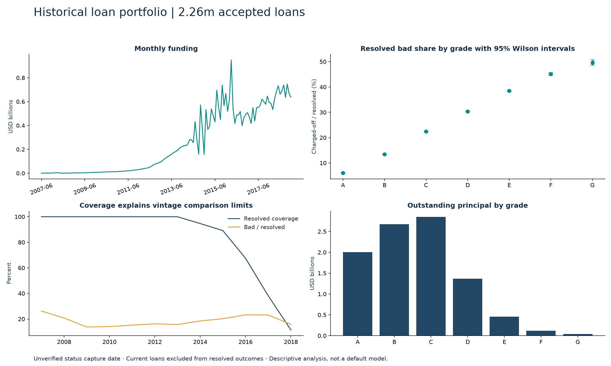
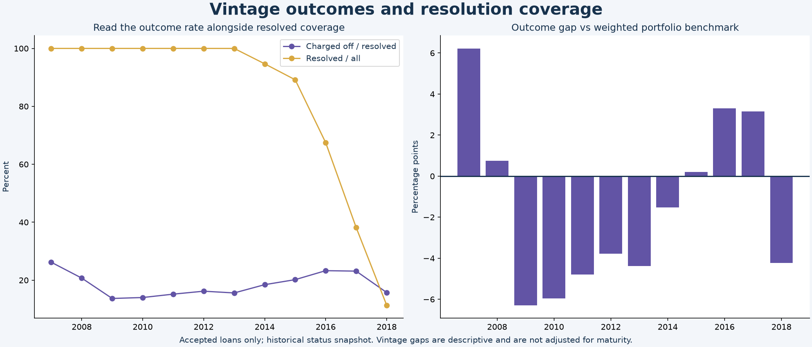

# Banking Credit Risk and Loan Portfolio Analytics

A descriptive review of LendingClub's historical accepted-loan portfolio. The analysis separates resolved outcomes from current exposure so that grade and vintage comparisons have an explicit denominator.



**Tools:** Python, pandas, NumPy, MySQL 8, SQLAlchemy, Power Query, Power BI and DAX. The project contains 21 executed MySQL business queries and 26 report measures. 

## Portfolio findings

- **2,260,668 valid loans** represent **USD 34.00bn in funded principal**.
- **269,320 charged-off loans / 1,348,059 resolved loans = 19.98%**. This is an observed resolved-outcome share, not a lifetime default estimate.
- Only **59.63% of loans are resolved**. Comparing vintages requires checking that coverage alongside the outcome share.

## Analysis question

Where do funding, unresolved exposure and observed charged-off outcomes concentrate, and how does maturity affect comparisons across vintages and grades?

## Explore the deliverables

- [Business findings](reports/BUSINESS_FINDINGS.md)
- [Interactive offline dashboard](reports/Interactive_Dashboard.html) — download and open in a browser; GitHub does not execute HTML.
- [Native Power BI project](powerbi/Loan_Portfolio.pbip) — download the repository and open in Power BI Desktop.
- [DAX definitions and scope](powerbi/MEASURE_DEFINITIONS.md)
- [21 MySQL questions and queries](sql/analysis_queries.sql)
- [Executed notebook](notebooks/01_analysis.ipynb)
- [Data quality decisions](reports/DATA_QUALITY.md), [dictionary](reports/DATA_DICTIONARY.md) and [MySQL reconciliation](reports/mysql_validation.json)

## Reproduce

Use Python 3.11+ and MySQL 8.0+. Install `requirements.txt` in a virtual environment. Keep source data outside Git.

```text
pip install -r requirements.txt
python src/pipeline.py --source "PATH_TO_SOURCE_FILE"
python src/comparison_analysis.py
python -m pytest tests -q
```

Create an empty local MySQL database, set `DATABASE_URL` using `.env.example` as a reference (the loader reads the environment, not the file automatically), enable LOCAL INFILE on your local server and run `python src/database.py`. The loader refuses nonempty tables and checks bulk-load warnings. It creates relational tables, constraints, views and query result CSVs. Never point this loader at a production database.

Open `powerbi/Loan_Portfolio.pbip`, set the DataRoot parameter to the local `data/` folder with a trailing slash and Refresh. See [report instructions](powerbi/OPEN_REPORT.md). Full processed data is generated locally, not committed. The native model is CSV-backed; MySQL independently validates the same transformed facts.

## Model and quality

One loan per fact row, with original loan identifiers preserved and a source-row surrogate key. MySQL provides grade, state and purpose lookup constraints; the Power BI model uses one denormalized loan table to preserve exact snapshot fields and simplify filtering.

Python and MySQL totals reconcile independently. Unit tests cover analytical failure cases, including status classification and resolved-outcome denominators. Report visuals and refresh status are documented separately; query execution does not prove every business interpretation.

## Source and limitations

[LendingClub historical data listing](https://www.kaggle.com/datasets/wordsforthewise/lending-club). Original source filename accepted_2007_to_2018Q4.csv. Dataset redistribution terms are not verified; raw data is excluded.

Accepted-only selection, unresolved loans and unverified status capture date limit inference. No predictive model or credit approval recommendation is made. Wilson intervals do not remove selection or maturity bias.

Code and original documentation use the MIT license. Source datasets retain their own rights. Review the [publication checklist](reports/PUBLICATION_CHECKLIST.md) before sharing. Prepared by Singara Prem Sagar as a portfolio study.

## Comparison view



[Open the comparison dashboard](reports/Comparison_Dashboard.html) after downloading the repository; these comparison charts require an internet connection for Plotly.

Vintage comparison adds a focused review page with two contextual measures, a comparison table, chart tooltips and a project-specific theme. Compare outcomes alongside resolved coverage. Gaps are percentage points versus selected vintages, retain grade filters, and do not adjust for maturity. SQL Q21 provides the related aggregate analysis. See [enhancement checks](reports/COMPARISON_VALIDATION.md).

Current report: **5 pages, 26 DAX measures and 21 SQL analyses**.
